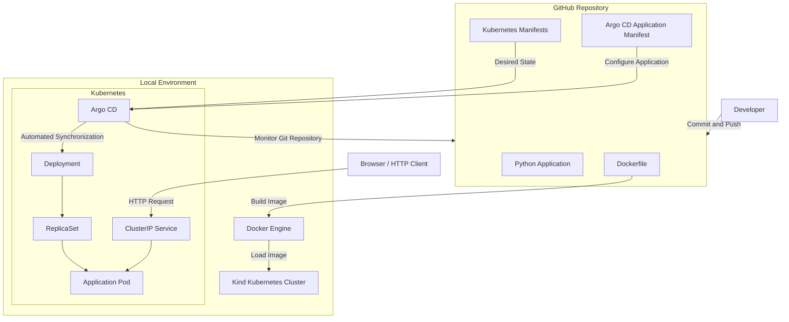
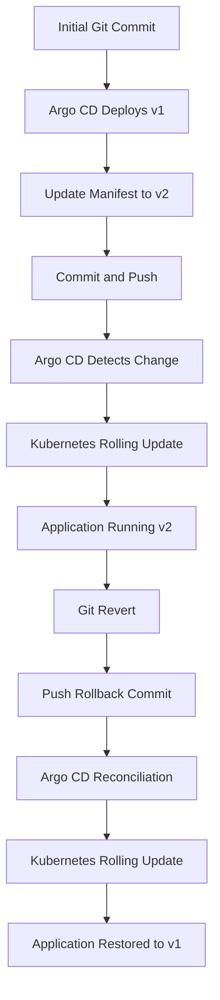

# GitOps Continuous Deployment Platform

**Automated Kubernetes deployments using GitOps, Argo CD, continuous synchronization, and Git-based rollback.**


---

## 1. Project Overview

The **GitOps Continuous Deployment Platform** is a local Kubernetes deployment automation project designed to demonstrate how GitOps can simplify application deployment, synchronization, and rollback.

The main objective is to automate application deployments using Git as the single source of truth.

Instead of manually deploying application updates to Kubernetes using `kubectl`, the project uses Argo CD to continuously monitor a GitHub repository and reconcile the Kubernetes cluster with the desired configuration stored in Git.

Whenever a Kubernetes manifest is updated and pushed to GitHub:

1. Argo CD detects the repository change.
2. Argo CD retrieves the updated Kubernetes manifests.
3. It compares the desired state in Git with the actual state in Kubernetes.
4. Automated synchronization applies the required changes.
5. Kubernetes updates the application through a rolling deployment.
6. Argo CD reports the synchronization and application health status.

The project also demonstrates rollback support using Git.

When an application update introduces an unwanted change, the previous configuration can be restored by reverting the Git commit. Argo CD detects the reverted configuration and automatically restores the application.

### Main objectives

- Implement GitOps-based continuous deployment.
- Automate Kubernetes deployments using Argo CD.
- Maintain Git as the single source of truth.
- Enable automated synchronization and self-healing.
- Demonstrate application version updates through Git commits.
- Implement Git-based rollback and recovery.
- Run the entire platform locally without requiring paid cloud infrastructure.

### Project repository

GitHub: https://github.com/bhavithreddy/gitops-continuous-deployment

---

## 2. Architecture

### High-level architecture

The platform follows a GitOps-based deployment architecture.

GitHub stores the application source code and Kubernetes manifests. Argo CD monitors the repository and continuously reconciles the Kubernetes cluster with the desired state defined in Git.



### Architecture explanation

**1. Developer**

The developer modifies the application or Kubernetes configuration and pushes changes to the GitHub repository.

Git commits represent the desired deployment configuration.

**2. GitHub Repository**

GitHub stores:

- Python application source code.
- Dockerfile.
- Kubernetes Deployment manifest.
- Kubernetes Service manifest.
- Argo CD Application manifest.
- Kind cluster configuration.

The repository acts as the source of truth for Kubernetes configuration.

**3. Docker**

Docker packages the Python application and its runtime dependencies into a container image.

The image is built locally and loaded into the Kind cluster.

This avoids the need for a public or private container registry for this demonstration.

**4. Kind**

Kind (Kubernetes in Docker) creates a local Kubernetes cluster using Docker containers as Kubernetes nodes.

The project uses one control-plane node to keep the environment lightweight.

**5. Argo CD**

Argo CD is the GitOps continuous delivery controller.

It monitors the GitHub repository, compares the desired state with the actual Kubernetes state, and automatically synchronizes changes.

**6. Kubernetes Deployment**

The Deployment manages the application replicas and ensures that the desired number of Pods are running.

When the Pod template changes, Kubernetes creates a new ReplicaSet and replaces the previous Pods through a rolling update.

**7. Kubernetes Service**

The Service provides a stable network endpoint for accessing the application Pods.

The application uses a ClusterIP Service that exposes port 80 and forwards traffic to container port 8080.

**8. Application**

The Python HTTP server provides:

- A homepage displaying the application version.
- A health-check endpoint at `/health`.

The application is accessed locally through Kubernetes port forwarding.

---

## 3. Technology Stack

| Technology | Purpose |
|---|---|
| Git | Version control |
| GitHub | Source code and configuration repository |
| Docker | Application containerization |
| Kind | Local Kubernetes cluster |
| Kubernetes | Container orchestration |
| Argo CD | GitOps continuous deployment |
| Python 3.12 | Demo application |
| YAML | Kubernetes and Argo CD configuration |
| kubectl | Kubernetes cluster management |
| WSL2 Ubuntu | Linux development environment |
| Windows | Host operating system |

### Why these technologies?

**Git and GitHub**

Git provides version history and allows deployment configurations to be tracked. GitHub hosts the repository that Argo CD monitors.

**Docker**

Docker ensures that the application runs inside a consistent container environment.

**Kind**

Kind provides a lightweight local Kubernetes cluster without requiring a cloud Kubernetes service.

**Kubernetes**

Kubernetes manages application Pods, Deployments, ReplicaSets, Services, health checks, and rolling updates.

**Argo CD**

Argo CD automates deployment by continuously comparing Git repository configurations with the live Kubernetes cluster.

---

## 4. Development Environment

The project was implemented locally using Windows and WSL2 Ubuntu.

### Environment details

| Component | Configuration |
|---|---|
| Operating System | Windows with WSL2 Ubuntu |
| Processor | Intel Core i5-10300H |
| Physical RAM | Approximately 8 GB |
| WSL Memory Allocation | 6 GB |
| WSL CPU Allocation | 4 processors |
| Container Runtime | Docker |
| Kubernetes Distribution | Kind |
| Kubernetes Version | v1.37.0 |
| Kind Version | v0.33.0 |
| kubectl Client | v1.36.3 |
| Cluster Name | gitops-platform |
| Cluster Nodes | 1 control-plane node |

The platform was intentionally designed to operate locally because the project did not require cloud infrastructure.

---

## 5. Repository Structure

```text
gitops-continuous-deployment/
│
├── app/
│   ├── app.py
│   └── Dockerfile
│
├── k8s/
│   ├── deployment.yaml
│   └── service.yaml
│
├── argocd/
│   └── application.yaml
│
├── screenshots/
│
├── kind-config.yaml
│
├── .gitignore
│
└── README.md
```

### Directory explanation

**app/**

Contains the Python application and its Dockerfile.

**k8s/**

Contains Kubernetes manifests defining the application Deployment and Service.

**argocd/**

Contains the Argo CD Application resource that connects the Kubernetes cluster to the GitHub repository.

**screenshots/**

Contains screenshots documenting the implementation, deployment, synchronization, and rollback demonstrations.

**kind-config.yaml**

Defines the local Kind Kubernetes cluster configuration.

**.gitignore**

Prevents unnecessary local files, Python cache files, virtual environments, and IDE configuration from being committed.

---

# 6. Implementation: Step by Step

## Phase 1: Create the local Kubernetes cluster

The first step was to prepare a local Kubernetes environment using Kind.

### Why Kind?

Kind runs Kubernetes nodes inside Docker containers.

It allows Kubernetes workloads to be deployed and tested locally without creating an AWS EKS cluster or paying for cloud infrastructure.

### Cluster configuration

File: `kind-config.yaml`

```yaml
kind: Cluster
apiVersion: kind.x-k8s.io/v1alpha4

name: gitops-platform

nodes:
  - role: control-plane
```

### Configuration explanation

- `kind: Cluster` defines a Kind cluster configuration.
- `apiVersion` specifies the Kind configuration API version.
- `name` defines the cluster name.
- `nodes` specifies the Kubernetes nodes.
- `role: control-plane` creates one Kubernetes control-plane node.

A single-node cluster was selected to minimize resource consumption on the development machine.

### Create the cluster

```bash
kind create cluster \
  --config kind-config.yaml \
  --name gitops-platform \
  --image kindest/node:v1.37.0 \
  --wait 120s
```

### Verify the cluster

```bash
kind get clusters
```

```bash
kubectl cluster-info
```

```bash
kubectl get nodes -o wide
```

Expected result:

The `gitops-platform-control-plane` node should be in `Ready` status.

### Verify system Pods

```bash
kubectl get pods -n kube-system
```

The Kubernetes system components should be running.

---

## Phase 2: Develop the Python application

A lightweight Python HTTP server was created as the demonstration application.

The application does not require external Python libraries.

It uses Python's built-in HTTP server functionality.

File: `app/app.py`

```python
import json
import os
from http.server import BaseHTTPRequestHandler, HTTPServer

APP_VERSION = os.getenv("APP_VERSION", "v1")


class AppHandler(BaseHTTPRequestHandler):

    def do_GET(self):
        if self.path == "/health":
            self.send_response(200)
            self.send_header("Content-Type", "application/json")
            self.end_headers()

            self.wfile.write(
                json.dumps({"status": "healthy"}).encode()
            )

        elif self.path == "/":
            self.send_response(200)
            self.send_header("Content-Type", "text/html")
            self.end_headers()

            html = f"""
            <html>
              <head><title>GitOps Demo</title></head>
              <body>
                <h1>GitOps Continuous Deployment Platform</h1>
                <h2>Application Version: {APP_VERSION}</h2>
                <p>Deployed and managed by Argo CD.</p>
              </body>
            </html>
            """

            self.wfile.write(html.encode())

        else:
            self.send_response(404)
            self.end_headers()


server = HTTPServer(("0.0.0.0", 8080), AppHandler)

print(f"GitOps Demo running: {APP_VERSION}")

server.serve_forever()
```

### Application explanation

**Import statements**

```python
import json
import os
from http.server import BaseHTTPRequestHandler, HTTPServer
```

- `json` generates the health-check response.
- `os` reads environment variables.
- `BaseHTTPRequestHandler` processes incoming HTTP requests.
- `HTTPServer` starts the HTTP server.

**Application version**

```python
APP_VERSION = os.getenv("APP_VERSION", "v1")
```

The application reads the `APP_VERSION` environment variable.

If the environment variable is not defined, the default version is `v1`.

This variable is important for demonstrating GitOps deployment updates.

**Health endpoint**

```python
if self.path == "/health":
```

The `/health` endpoint returns:

```json
{
  "status": "healthy"
}
```

Kubernetes uses this endpoint for readiness and liveness probes.

**Homepage**

```python
elif self.path == "/":
```

The homepage displays:

- Project name.
- Current application version.
- Deployment information.

**HTTP server**

```python
server = HTTPServer(("0.0.0.0", 8080), AppHandler)
```

The application listens on port 8080 and accepts connections through the container network interface.

---

## Phase 3: Containerize the application

A Dockerfile was created to package the Python application into a Docker image.

File: `app/Dockerfile`

```dockerfile
FROM python:3.12-slim

WORKDIR /app

RUN useradd --system --uid 10001 appuser

COPY app.py .

ENV APP_VERSION=v1

USER 10001

EXPOSE 8080

CMD ["python", "-u", "app.py"]
```

### Dockerfile explanation

**Base image**

```dockerfile
FROM python:3.12-slim
```

Uses a lightweight Python 3.12 image.

**Working directory**

```dockerfile
WORKDIR /app
```

Sets `/app` as the working directory inside the container.

**Create a non-root user**

```dockerfile
RUN useradd --system --uid 10001 appuser
```

Creates a dedicated system user with UID 10001.

Running the application as a non-root user reduces unnecessary container privileges.

**Copy application**

```dockerfile
COPY app.py .
```

Copies the Python source file into the container.

**Default environment variable**

```dockerfile
ENV APP_VERSION=v1
```

Sets the default application version.

**Non-root execution**

```dockerfile
USER 10001
```

Runs the application using the dedicated non-root user.

**Expose application port**

```dockerfile
EXPOSE 8080
```

Documents the application's listening port.

**Start application**

```dockerfile
CMD ["python", "-u", "app.py"]
```

Starts the Python HTTP server.

The `-u` option enables unbuffered output so application logs are emitted immediately.

### Build the Docker image

From the project root:

```bash
docker build -t gitops-demo:v1 ./app
```

### Verify the image

```bash
docker images
```

### Load the image into Kind

```bash
kind load docker-image gitops-demo:v1 \
  --name gitops-platform
```

### Verify the image inside the Kind node

```bash
docker exec gitops-platform-control-plane \
  crictl images | grep gitops-demo
```

The image must be available inside the Kubernetes node before the Deployment starts.

This project uses a locally loaded image and does not require an external container registry.

---

## Phase 4: Create Kubernetes manifests

Kubernetes manifests define the desired state of the application.

Two primary resources were created:

1. Deployment
2. Service

### 4.1 Deployment configuration

File: `k8s/deployment.yaml`

```yaml
apiVersion: apps/v1

kind: Deployment

metadata:
  name: gitops-demo
  namespace: default

spec:
  replicas: 1

  selector:
    matchLabels:
      app: gitops-demo

  template:
    metadata:
      labels:
        app: gitops-demo

    spec:
      containers:
        - name: gitops-demo

          image: gitops-demo:v1

          imagePullPolicy: IfNotPresent

          ports:
            - containerPort: 8080

          env:
            - name: APP_VERSION
              value: "v1"

          readinessProbe:
            httpGet:
              path: /health
              port: 8080
            initialDelaySeconds: 3
            periodSeconds: 5

          livenessProbe:
            httpGet:
              path: /health
              port: 8080
            initialDelaySeconds: 10
            periodSeconds: 10

          resources:
            requests:
              cpu: 50m
              memory: 64Mi

            limits:
              cpu: 250m
              memory: 128Mi
```

### Deployment configuration explained

**API version**

```yaml
apiVersion: apps/v1
```

Uses the Kubernetes Deployment API.

**Resource kind**

```yaml
kind: Deployment
```

Defines a Kubernetes Deployment.

**Metadata**

```yaml
metadata:
  name: gitops-demo
  namespace: default
```

Defines the resource name and namespace.

**Replica count**

```yaml
replicas: 1
```

Maintains one application Pod.

One replica was selected to keep the local project lightweight.

**Selector**

```yaml
selector:
  matchLabels:
    app: gitops-demo
```

Identifies Pods managed by the Deployment.

**Pod template labels**

```yaml
labels:
  app: gitops-demo
```

Labels the application Pod so that Kubernetes resources can identify it.

**Container image**

```yaml
image: gitops-demo:v1
```

Specifies the locally built Docker image.

**Image pull policy**

```yaml
imagePullPolicy: IfNotPresent
```

Allows Kubernetes to use the image already available inside the Kind node.

This is important because the project uses a locally loaded image instead of a remote registry.

**Container port**

```yaml
containerPort: 8080
```

Documents the application container port.

**Environment variable**

```yaml
env:
  - name: APP_VERSION
    value: "v1"
```

Passes the application version into the running container.

This field is the main configuration used to demonstrate continuous deployment.

When this value changes, Kubernetes detects a change in the Pod template and creates a new ReplicaSet.

**Readiness probe**

```yaml
readinessProbe:
  httpGet:
    path: /health
    port: 8080
```

Checks whether the application is ready to receive traffic.

If the readiness check fails, the Pod is not considered ready for Service traffic.

**Liveness probe**

```yaml
livenessProbe:
  httpGet:
    path: /health
    port: 8080
```

Checks whether the application is still functioning.

Kubernetes can restart a container if its liveness probe repeatedly fails.

**Resource requests**

```yaml
requests:
  cpu: 50m
  memory: 64Mi
```

Defines the minimum resources requested for scheduling.

**Resource limits**

```yaml
limits:
  cpu: 250m
  memory: 128Mi
```

Defines the maximum CPU and memory resources available to the container.

These values help keep the local application lightweight.

### 4.2 Service configuration

File: `k8s/service.yaml`

```yaml
apiVersion: v1

kind: Service

metadata:
  name: gitops-demo
  namespace: default

spec:
  selector:
    app: gitops-demo

  ports:
    - name: http
      port: 80
      targetPort: 8080

  type: ClusterIP
```

### Service configuration explained

**Resource type**

```yaml
kind: Service
```

Creates a Kubernetes Service.

**Service selector**

```yaml
selector:
  app: gitops-demo
```

Selects application Pods with the matching label.

**Service port**

```yaml
port: 80
```

The port exposed by the Service inside the cluster.

**Target port**

```yaml
targetPort: 8080
```

Forwards traffic to port 8080 inside the application container.

**Service type**

```yaml
type: ClusterIP
```

Creates an internal Kubernetes Service accessible within the cluster.

The application is accessed externally through `kubectl port-forward`.

### Validate the manifests

```bash
kubectl apply --dry-run=client -f k8s/
```

This validates the manifests without creating the actual application resources.

The application resources are intentionally deployed by Argo CD rather than manually applied.

---

## Phase 5: Initialize Git and push the project to GitHub

Git was initialized to maintain application and deployment configuration history.

### Initialize Git

```bash
git init
```

### Set the main branch

```bash
git branch -M main
```

### Create .gitignore

```gitignore
__pycache__/
*.py[cod]
.venv/
venv/
.env
.idea/
.vscode/
```

This prevents Python cache files, virtual environments, environment files, and IDE-specific files from being committed.

### Add project files

```bash
git add .
```

### Create initial commit

```bash
git commit -m "Initial commit: GitOps demo application and Kubernetes manifests"
```

### Connect GitHub repository

```bash
git remote add origin \
  https://github.com/bhavithreddy/gitops-continuous-deployment.git
```

### Push to GitHub

```bash
git push -u origin main
```

GitHub now contains the application code and Kubernetes configuration.

---

## Phase 6: Install and configure Argo CD

Argo CD is the central component of the GitOps deployment platform.

It continuously monitors the configured Git repository and reconciles Kubernetes resources with the desired configuration.

### Create the Argo CD namespace

```bash
kubectl create namespace argocd
```

Namespaces provide logical separation between Kubernetes resources.

Argo CD is installed in the `argocd` namespace, while the demo application runs in the `default` namespace.

### Install Argo CD

```bash
kubectl apply -n argocd \
  -f https://raw.githubusercontent.com/argoproj/argo-cd/stable/manifests/install.yaml
```

### Installation issue encountered

During the initial installation, the following error occurred:

```text
CustomResourceDefinition "applicationsets.argoproj.io"
is invalid:
metadata.annotations: Too long:
may not be more than 262144 bytes
```

This occurred because the client-side apply operation attempted to store a large last-applied configuration annotation on the CustomResourceDefinition.

### Resolution

The installation was reapplied using server-side apply:

```bash
kubectl apply --server-side --force-conflicts \
  -n argocd \
  -f https://raw.githubusercontent.com/argoproj/argo-cd/stable/manifests/install.yaml
```

Server-side apply uses Kubernetes managed fields rather than relying on the same large client-side last-applied annotation.

The required Argo CD resources were successfully registered.

### Verify Argo CD Pods

```bash
kubectl get pods -n argocd
```

### Verify Argo CD deployments

```bash
kubectl get deployments -n argocd
```

The Argo CD components should become available.

### Access the Argo CD UI

Start port forwarding:

```bash
kubectl port-forward svc/argocd-server \
  -n argocd 8080:443
```

Open:

```text
https://localhost:8080
```

### Retrieve the initial admin password

```bash
kubectl -n argocd get secret argocd-initial-admin-secret \
  -o jsonpath="{.data.password}" | base64 -d
```

Username:

```text
admin
```

Use the retrieved password to log in.

The initial password is a bootstrap credential. It should not be committed to GitHub or included in screenshots.

---

## Phase 7: Configure the Argo CD Application

An Argo CD Application resource connects the GitHub repository to the Kubernetes cluster.

It tells Argo CD:

- Which repository to monitor.
- Which Git branch to track.
- Which directory contains Kubernetes manifests.
- Which cluster and namespace should receive the resources.
- How synchronization should work.

File: `argocd/application.yaml`

```yaml
apiVersion: argoproj.io/v1alpha1

kind: Application

metadata:
  name: gitops-demo
  namespace: argocd

spec:
  project: default

  source:
    repoURL: https://github.com/bhavithreddy/gitops-continuous-deployment.git
    targetRevision: main
    path: k8s

  destination:
    server: https://kubernetes.default.svc
    namespace: default

  syncPolicy:
    automated:
      prune: true
      selfHeal: true

    syncOptions:
      - CreateNamespace=true
```

### Configuration explanation

**API version**

```yaml
apiVersion: argoproj.io/v1alpha1
```

Specifies the Argo CD Application API.

**Resource kind**

```yaml
kind: Application
```

Defines an Argo CD Application resource.

**Application name**

```yaml
metadata:
  name: gitops-demo
  namespace: argocd
```

Creates the Argo CD Application named `gitops-demo` inside the `argocd` namespace.

**Argo CD project**

```yaml
project: default
```

Uses the default Argo CD project.

**Git repository**

```yaml
repoURL: https://github.com/bhavithreddy/gitops-continuous-deployment.git
```

Specifies the GitHub repository.

**Target revision**

```yaml
targetRevision: main
```

Tells Argo CD to monitor the `main` branch.

**Manifest path**

```yaml
path: k8s
```

Specifies the directory containing the Kubernetes manifests.

Argo CD reads the Deployment and Service configuration from this directory.

**Destination cluster**

```yaml
server: https://kubernetes.default.svc
```

Specifies the Kubernetes API server inside the cluster where Argo CD is running.

**Destination namespace**

```yaml
namespace: default
```

Deploys the application resources into the `default` namespace.

### Automated synchronization

```yaml
syncPolicy:
  automated:
    prune: true
    selfHeal: true
```

This configuration enables automated synchronization.

**Automated sync**

Argo CD automatically applies changes detected in the Git repository.

**Prune**

```yaml
prune: true
```

Removes Kubernetes resources that were previously managed by the Application but have been removed from the desired manifests.

**Self-heal**

```yaml
selfHeal: true
```

Detects and corrects supported live-cluster configuration drift by restoring the desired configuration from Git.

**CreateNamespace**

```yaml
syncOptions:
  - CreateNamespace=true
```

Allows Argo CD to create the destination namespace if it does not already exist.

### Commit the Argo CD configuration

```bash
git add argocd/application.yaml
git commit -m "Add Argo CD application configuration"
git push origin main
```

### Create the Argo CD Application

```bash
kubectl apply -f argocd/application.yaml
```

### Verify the application

```bash
kubectl get applications -n argocd
```

Expected status:

```text
NAME          SYNC STATUS   HEALTH STATUS
gitops-demo   Synced        Healthy
```

Argo CD has now connected GitHub to the local Kubernetes cluster.

---

## Phase 8: Verify the initial deployment

After creating the Argo CD Application, Argo CD retrieves the Kubernetes manifests from GitHub and deploys the application.

### Verify the Deployment

```bash
kubectl get deployment gitops-demo
```

### Verify Pods

```bash
kubectl get pods -n default
```

### Verify the Service

```bash
kubectl get service gitops-demo
```

### Verify the Service endpoints

```bash
kubectl get endpoints gitops-demo
```

The Service should have an endpoint pointing to the application Pod on port 8080.

### Verify Argo CD

```bash
kubectl get applications -n argocd
```

Expected:

```text
gitops-demo   Synced   Healthy
```

### Access the application

Start port forwarding:

```bash
kubectl port-forward svc/gitops-demo 8081:80
```

Open the application:

```text
http://localhost:8081/
```

Health endpoint:

```text
http://localhost:8081/health
```

Expected health response:

```json
{
  "status": "healthy"
}
```

Expected homepage:

```text
GitOps Continuous Deployment Platform
Application Version: v1
Deployed and managed by Argo CD.
```

At this point, the first GitOps deployment is complete.

---

# 7. Continuous Synchronization Demonstration

This phase demonstrates how Argo CD detects a Git change and automatically updates the Kubernetes application.

The application version was initially set to `v1`.

The goal was to change it to `v2` without manually modifying the live Kubernetes Deployment.

### Step 1: Update the Git manifest

Open:

```text
k8s/deployment.yaml
```

Find:

```yaml
env:
  - name: APP_VERSION
    value: "v1"
```

Change it to:

```yaml
env:
  - name: APP_VERSION
    value: "v2"
```

This changes the desired application configuration in Git.

### Step 2: Commit the change

```bash
git add k8s/deployment.yaml
```

```bash
git commit -m "Update demo application version to v2"
```

### Step 3: Push the change to GitHub

```bash
git push origin main
```

The v2 commit was:

```text
8b53bd4 Update demo application version to v2
```

### Step 4: Argo CD detects the change

Argo CD periodically refreshes the repository and compares the new desired configuration with the current cluster state.

A hard refresh can also be requested:

```bash
kubectl annotate application gitops-demo \
  -n argocd \
  argocd.argoproj.io/refresh=hard \
  --overwrite
```

This requests an immediate repository and application refresh.

It does not manually apply the Deployment.

Automated synchronization remains responsible for applying the change.

### Step 5: Verify synchronization

```bash
kubectl get applications -n argocd
```

Expected:

```text
NAME          SYNC STATUS   HEALTH STATUS
gitops-demo   Synced        Healthy
```

### Step 6: Verify the Deployment environment variable

```bash
kubectl get deployment gitops-demo \
  -o jsonpath='{.spec.template.spec.containers[0].env[?(@.name=="APP_VERSION")].value}{"\n"}'
```

Expected:

```text
v2
```

### Step 7: Verify the rolling update

```bash
kubectl rollout status deployment/gitops-demo
```

```bash
kubectl get pods -n default
```

Kubernetes creates a new ReplicaSet because the Pod template changed.

The new Pod becomes ready, and the previous Pod is terminated.

### Step 8: Verify the application

```bash
curl http://localhost:8081/
```

Expected:

```text
Application Version: v2
```

### Important technical detail

The Docker image was not rebuilt during this version update.

The same locally loaded image, `gitops-demo:v1`, was used.

The application version was changed through the Kubernetes environment variable:

```yaml
APP_VERSION: "v2"
```

Because the environment variable is part of the Pod template, changing it triggers a Kubernetes rolling update.

This demonstrates how GitOps can update application configuration and trigger deployments without rebuilding the container image.

---

# 8. Git-Based Rollback Demonstration

Rollback support is one of the main objectives of this project.

The rollback was implemented using Git rather than directly modifying the live Kubernetes Deployment.

This maintains Git as the single source of truth.

### Rollback scenario

The application was successfully updated from v1 to v2.

To demonstrate recovery, the previous known-good configuration was restored by reverting the Git commit.

### Step 1: Inspect Git history

```bash
git log --oneline -5
```

Relevant history:

```text
8b53bd4 Update demo application version to v2
68d609c Add Argo CD application configuration
a7b92e4 Initial commit
```

### Step 2: Revert the v2 commit

```bash
git revert 8b53bd4
```

Git creates a new commit that reverses the changes introduced by the v2 commit.

The resulting rollback commit was:

```text
ab7ccc6 Revert "Update demo application version to v2"
```

### Why use git revert?

`git revert` creates a new commit that reverses an earlier commit.

It preserves the original Git history.

This is preferable to rewriting published Git history when demonstrating a collaborative deployment workflow.

### Step 3: Verify the rollback configuration

```bash
grep -A2 'name: APP_VERSION' k8s/deployment.yaml
```

Expected:

```yaml
- name: APP_VERSION
  value: "v1"
```

### Step 4: Push the rollback commit

```bash
git push origin main
```

The rollback commit is now available in GitHub.

### Step 5: Refresh Argo CD

```bash
kubectl annotate application gitops-demo \
  -n argocd \
  argocd.argoproj.io/refresh=hard \
  --overwrite
```

Argo CD detects the reverted Git configuration.

Automated synchronization restores the desired Deployment configuration.

### Step 6: Verify Argo CD status

```bash
kubectl get applications -n argocd
```

Expected:

```text
NAME          SYNC STATUS   HEALTH STATUS
gitops-demo   Synced        Healthy
```

### Step 7: Verify the Kubernetes Deployment

```bash
kubectl get deployment gitops-demo \
  -o jsonpath='{.spec.template.spec.containers[0].env[?(@.name=="APP_VERSION")].value}{"\n"}'
```

Expected:

```text
v1
```

### Step 8: Verify the new Pod

```bash
kubectl get pods -n default -o wide
```

Check the running Pod's environment variable:

```bash
kubectl exec -n default <POD_NAME> -- printenv APP_VERSION
```

Expected:

```text
v1
```

### Step 9: Verify the actual application response

```bash
kubectl exec -n default <POD_NAME> -- \
  python -c "import urllib.request; print(urllib.request.urlopen('http://localhost:8080/').read().decode())"
```

Then verify through the Service:

```bash
curl http://localhost:8081/
```

Expected:

```text
Application Version: v1
```

### Rollback troubleshooting encountered

During the rollback test, Kubernetes showed the Deployment and running Pod configured with v1, while an earlier HTTP request returned v2.

The investigation included:

```bash
kubectl get pods -n default -o wide
```

```bash
kubectl get replicasets -n default
```

```bash
kubectl get endpointslice \
  -n default \
  -l kubernetes.io/service-name=gitops-demo \
  -o wide
```

The running container was checked directly:

```bash
kubectl exec -n default <POD_NAME> -- printenv APP_VERSION
```

The direct request inside the Pod confirmed v1.

The local port-forward connection was then retested. After reconnecting, the Service returned v1 as expected.

This verified that the rollback was successful and that the temporary HTTP response issue was related to the port-forward connection during the Pod replacement.

### Final rollback result

```text
GitHub desired version: v1

Argo CD:
  Sync Status: Synced
  Health Status: Healthy

Kubernetes:
  Deployment: v1
  Pod: Running

Application:
  Version: v1
```

The rollback was completed without using:

```bash
kubectl rollout undo
```

Instead, Git was used to restore the previous desired configuration, and Argo CD reconciled Kubernetes automatically.

---

# 9. Git Commit History

The actual Git commit history demonstrates the project implementation and deployment lifecycle.

| Commit | Description |
|---|---|
| `a7b92e4` | Initial application and Kubernetes manifests |
| `68d609c` | Add Argo CD Application configuration |
| `8b53bd4` | Update demo application version to v2 |
| `ab7ccc6` | Revert v2 update and restore v1 |

### Deployment lifecycle



---

# 10. Important GitOps and Kubernetes Concepts Demonstrated

### GitOps

GitOps is an operational approach where Git stores the desired configuration of an application or infrastructure.

In this project, GitHub contains the desired Kubernetes configuration.

Argo CD continuously compares that configuration with the actual cluster state.

### Desired state

The desired state describes how the application should run.

For this project, it is defined by:

- Deployment replica count.
- Container image.
- Application environment variables.
- Container ports.
- Health probes.
- Resource requests and limits.
- Service configuration.

### Actual state

The actual state is the configuration currently running inside Kubernetes.

Argo CD compares the actual state against the desired state.

### Reconciliation

Reconciliation is the process of detecting differences between desired and actual states and bringing the cluster back into alignment.

For example:

```text
Git desired state: APP_VERSION=v2

Kubernetes actual state: APP_VERSION=v1
```

Argo CD detects the difference and automated synchronization applies the v2 configuration.

### Automated synchronization

Automated synchronization allows Argo CD to apply detected Git changes without requiring manual synchronization through the UI or CLI.

### Self-healing

Self-healing helps correct supported configuration drift in the live cluster.

If a managed resource is changed manually, Argo CD can restore the desired configuration from Git.

### Pruning

Pruning removes managed Kubernetes resources that are no longer defined in the Git repository.

### Rolling update

A rolling update replaces old application Pods with new Pods gradually.

The Deployment controller creates a new ReplicaSet when the Pod template changes.

### Git-based rollback

Git-based rollback restores a previous desired configuration through a new Git commit.

Argo CD then applies that configuration to Kubernetes.

---

# 11. Troubleshooting and Issues Resolved

This project involved several real implementation and troubleshooting scenarios.

### Issue 1: Argo CD CRD installation error

**Error:**

```text
metadata.annotations: Too long:
may not be more than 262144 bytes
```

**Cause:**

The client-side apply operation exceeded the annotation size limit for a CustomResourceDefinition.

**Resolution:**

Reapplied the installation using server-side apply:

```bash
kubectl apply --server-side --force-conflicts \
  -n argocd \
  -f https://raw.githubusercontent.com/argoproj/argo-cd/stable/manifests/install.yaml
```

### Issue 2: Container image not available inside Kind

**Problem:**

A Docker image built on the host is not automatically available inside a Kind Kubernetes node.

**Resolution:**

Loaded the image explicitly:

```bash
kind load docker-image gitops-demo:v1 \
  --name gitops-platform
```

Verified it inside the node:

```bash
docker exec gitops-platform-control-plane \
  crictl images | grep gitops-demo
```

### Issue 3: Application startup and readiness

**Problem:**

The application initially returned connection-refused errors while the container was starting.

**Cause:**

The HTTP server was not yet listening when the initial readiness probe ran.

**Resolution:**

Configured readiness and liveness probes with appropriate initial delays and intervals.

Kubernetes subsequently marked the Pod ready.

### Issue 4: Argo CD repository refresh

**Problem:**

After pushing a Git change, the application did not immediately show the new version.

**Resolution:**

Requested a hard refresh:

```bash
kubectl annotate application gitops-demo \
  -n argocd \
  argocd.argoproj.io/refresh=hard \
  --overwrite
```

Then checked synchronization and Deployment status.

### Issue 5: Port-forward connection during rolling updates

**Problem:**

During application replacement, HTTP requests occasionally returned:

```text
curl: (52) Empty reply from server
```

**Cause:**

The existing port-forward connection became unreliable during Pod replacement.

**Resolution:**

Stopped and restarted the port-forward:

```bash
kubectl port-forward svc/gitops-demo 8081:80
```

Then retested the health endpoint and homepage.

### Issue 6: Old and new Pods during rollout

**Problem:**

The old Pod appeared in `Terminating` status while the new Pod was already running.

**Explanation:**

This is expected during Kubernetes rolling updates.

The Deployment controller creates and validates the new Pod before removing the previous one.

Verification:

```bash
kubectl rollout status deployment/gitops-demo
```

---

# 12. Useful Commands Reference

### Kind commands

```bash
kind get clusters
```

Lists Kind clusters.

```bash
kind load docker-image gitops-demo:v1 \
  --name gitops-platform
```

Loads a local image into Kind.

### Kubernetes commands

```bash
kubectl get nodes -o wide
```

Displays Kubernetes nodes.

```bash
kubectl get pods -A
```

Lists Pods across namespaces.

```bash
kubectl get deployments -n default
```

Lists application Deployments.

```bash
kubectl get services -n default
```

Lists Services.

```bash
kubectl get applications -n argocd
```

Displays Argo CD Applications.

```bash
kubectl describe deployment gitops-demo
```

Displays Deployment details and events.

```bash
kubectl logs deployment/gitops-demo
```

Displays application logs.

```bash
kubectl rollout status deployment/gitops-demo
```

Checks rollout completion.

```bash
kubectl get replicasets -n default
```

Displays ReplicaSets.

```bash
kubectl get endpointslice \
  -n default \
  -l kubernetes.io/service-name=gitops-demo
```

Displays the Service's backend endpoints.

### Argo CD commands

```bash
kubectl get pods -n argocd
```

Checks Argo CD Pods.

```bash
kubectl get applications -n argocd
```

Checks application synchronization and health.

```bash
kubectl describe application gitops-demo -n argocd
```

Displays Argo CD Application details.

```bash
kubectl annotate application gitops-demo \
  -n argocd \
  argocd.argoproj.io/refresh=hard \
  --overwrite
```

Requests a hard application refresh.

### Application access

```bash
kubectl port-forward svc/gitops-demo 8081:80
```

Forwards local port 8081 to the Kubernetes Service.

```bash
curl http://localhost:8081/
```

Checks the application homepage.

```bash
curl http://localhost:8081/health
```

Checks application health.

---

# 13. Project Screenshots

The `screenshots/` directory contains screenshots captured during the project implementation.

The following evidence should be included:

| Screenshot | What it demonstrates |
|---|---|
| Project structure | Repository organization |
| Application source | Python application implementation |
| Kubernetes manifests | Deployment and Service configuration |
| Kind cluster | Local Kubernetes cluster |
| Argo CD dashboard | Application synchronization and health |
| Argo CD resource tree | Kubernetes resources managed by Argo CD |
| Kubernetes workloads | Running Deployment, Pod, and Service |
| Application v1 | Initial deployment |
| GitHub v2 commit | Version change committed to Git |
| Argo CD synchronization | Automated deployment of v2 |
| Application v2 | Updated application |
| Git rollback commit | Revert operation |
| Argo CD after rollback | Restored synchronized state |
| Application v1 after rollback | Successful recovery |

Add screenshots using their actual filenames, for example:

```markdown

```

---

# 14. How to Reproduce the Project

Follow these steps to run the project locally.

### Prerequisites

Install:

- Docker
- Kind
- kubectl
- Git
- WSL2 Ubuntu or another supported Linux environment

### Step 1: Clone the repository

```bash
git clone https://github.com/bhavithreddy/gitops-continuous-deployment.git
```

```bash
cd gitops-continuous-deployment
```

### Step 2: Create the Kind cluster

```bash
kind create cluster \
  --config kind-config.yaml \
  --name gitops-platform \
  --image kindest/node:v1.37.0 \
  --wait 120s
```

### Step 3: Build the application image

```bash
docker build -t gitops-demo:v1 ./app
```

### Step 4: Load the image into Kind

```bash
kind load docker-image gitops-demo:v1 \
  --name gitops-platform
```

### Step 5: Install Argo CD

```bash
kubectl create namespace argocd
```

```bash
kubectl apply --server-side --force-conflicts \
  -n argocd \
  -f https://raw.githubusercontent.com/argoproj/argo-cd/stable/manifests/install.yaml
```

### Step 6: Wait for Argo CD

```bash
kubectl wait \
  --for=condition=Available \
  deployment \
  --all \
  -n argocd \
  --timeout=300s
```

Check the Argo CD Pods:

```bash
kubectl get pods -n argocd
```

### Step 7: Create the Argo CD Application

```bash
kubectl apply -f argocd/application.yaml
```

### Step 8: Verify deployment

```bash
kubectl get applications -n argocd
```

```bash
kubectl get deployments,pods,services -n default
```

### Step 9: Access the application

```bash
kubectl port-forward svc/gitops-demo 8081:80
```

Open:

```text
http://localhost:8081/
```

**Important:** This reproduction procedure assumes the repository's existing `main` branch contains the initial v1 configuration and the locally built image is loaded into the new Kind cluster. If you clone the repository after the v2 and rollback commits, its current manifests already contain v1.

---

# 15. Current Project Scope and Limitations

The project intentionally focuses on the core GitOps deployment lifecycle.

### Implemented

- Local Kubernetes environment.
- Containerized Python application.
- Kubernetes Deployment and Service.
- GitHub repository integration.
- Argo CD Application configuration.
- Automated synchronization.
- Self-healing configuration.
- Pruning configuration.
- Application version update.
- Kubernetes rolling update.
- Git-based rollback.
- Final deployment health verification.

### Not included

The following capabilities were outside the scope of this implementation:

- Cloud deployment using AWS, Azure, or GCP.
- Multi-cluster Kubernetes deployment.
- External container registry.
- CI pipeline for automated image builds.
- Helm-based application packaging.
- Prometheus and Grafana monitoring.
- Ingress or external load balancer.
- Production high availability.
- Multi-replica application deployment.

These are possible future extensions, not features currently implemented.

---

# 16. Key Learnings

Through this project, the following practical concepts were implemented and verified:

1. Creating and managing a local Kubernetes cluster using Kind.
2. Building Docker images and loading them into Kubernetes nodes.
3. Writing Kubernetes Deployment and Service manifests.
4. Configuring application health checks using readiness and liveness probes.
5. Understanding the relationship between Deployments, ReplicaSets, Pods, and Services.
6. Installing and configuring Argo CD.
7. Connecting a GitHub repository to a Kubernetes cluster through GitOps.
8. Understanding desired state versus actual state.
9. Implementing automated synchronization.
10. Understanding self-healing and pruning.
11. Triggering Kubernetes rolling updates through Git changes.
12. Implementing Git-based rollback with `git revert`.
13. Troubleshooting Kubernetes deployments and Argo CD synchronization.
14. Verifying application health at both Pod and Service levels.

---

# 17. Final Result

The GitOps Continuous Deployment Platform successfully demonstrates the complete deployment lifecycle.

**Initial deployment**

```text
GitHub → Argo CD → Kubernetes → Application v1
```

**Continuous deployment**

```text
Git change → Argo CD detects update → Kubernetes rollout → Application v2
```

**Rollback**

```text
Git revert → GitHub → Argo CD reconciliation → Kubernetes rollout → Application v1
```

### Final verification

```bash
kubectl get applications -n argocd
```

Verified result:

```text
NAME          SYNC STATUS   HEALTH STATUS
gitops-demo   Synced        Healthy
```

The application was also verified directly inside the running Pod and through the Kubernetes Service.

### Conclusion

This project demonstrates how GitOps simplifies Kubernetes application delivery by using Git as the source of truth and Argo CD as the continuous reconciliation mechanism.

Application updates and rollbacks are performed through Git commits, allowing Kubernetes to automatically converge toward the desired configuration.

The complete implementation was built and tested locally without requiring paid cloud infrastructure.

---

**Project:** GitOps Continuous Deployment Platform  
**Repository:** https://github.com/bhavithreddy/gitops-continuous-deployment  
**Primary technologies:** Docker, Kubernetes, Kind, Argo CD, Git, GitHub, Python.
